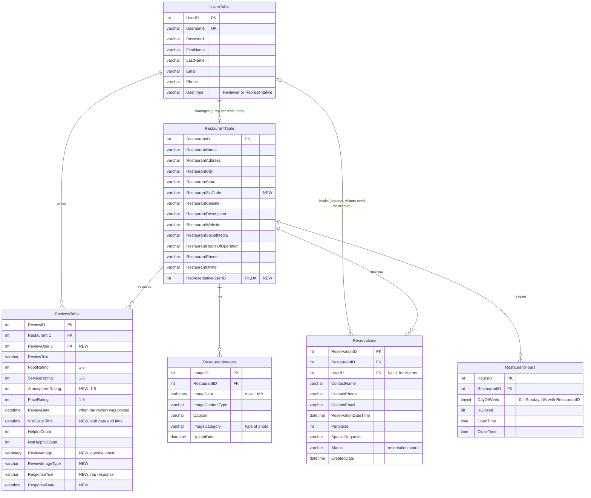

# CIS3342 Projects

Coursework for **CIS 3342 – Server-Side Web Application Development** (Temple University, Fall 2026).
Built with C#, ASP.NET Web Forms, SQL Server, and Bootstrap.

🌐 **Live homepage:** https://cis-iis2.temple.edu/Fall2026/CIS3342_tut54751/index.html

---

## Project 1 – Honest Plates (Restaurant Review Site)
**Status:** ✅ Complete
**Live app:** https://cis-iis2.temple.edu/Fall2026/CIS3342_tut54751/Project1/Home.aspx

A restaurant review site, backed by a SQL Server database, that helps diners find a place to eat and see what other people thought of it.

**What it does:**
- **Search:** filter restaurants by one or more cuisine types (American, Italian, Asian, and more) and by city/state. Each result card shows the restaurant's logo, its overall rating, and its food, service, and price ratings.
- **Restaurant profile:** a full page for each restaurant with its photo, address, description, cuisine, hours, phone, owner, and website/social links, plus an overall rating calculated from its reviews.
- **Reviews:** every review for the restaurant appears on its profile page, with the reviewer's name, the date, the written review, and food/service/price scores.
- **Rate a review:** visitors can mark any review **Helpful** or **Not Helpful**, and the counts update on the page.

**Data:** 30 restaurants with full profiles (16 in Philadelphia, PA) and 66 reviews.

---

## Project 2 – Honest Plates v2 (Accounts, Reviews & Reservations)
**Status:** ✅ Complete
**Live app:** https://cis-iis2.temple.edu/Fall2026/CIS3342_tut54751/Project2/Home.aspx

Turns Project 1 into a multi-user app. People can create accounts, log in, and see different tools depending on who they are.

**User types:**
| User | Account? | What they can do |
|------|----------|------------------|
| **Reviewer** | Yes | Post reviews, and edit or delete only their own reviews |
| **Restaurant Representative** | Yes | Create and manage one restaurant's profile, manage its reservations, respond to reviews, and review *other* restaurants (never their own) |
| **Site Visitor** | No | Search, view restaurants and reviews, and make reservations |

**What it does:**
- **Home:** a photo banner with the search (one or more cuisines + city/state), the top-rated restaurants in Philadelphia, and a "How it works" section for each kind of user.
- **Accounts & login:** register as a Reviewer or a Representative. Each user type sees its own dashboard of tools after logging in. Logging in or registering from a restaurant's "write a review" link goes straight to that review form.
- **Restaurant profiles (Reps):** add and edit a restaurant with a split-up address, cuisine, weekly hours, contact info, website/social links, and multiple photos with captions (Logo, Profile, Gallery). Photos are stored in the database and are limited to 1 MB each.
- **Reviews:** rate a visit on Food, Service, Atmosphere (1–5 ★), and Price (1–5 $), with written comments, the visit date and time, and an optional photo. Reviewers manage only their own reviews.
- **Rep responses:** reps can reply to reviews of their restaurant, and the reply shows publicly under the review.
- **Reservations (everyone):** book a table with name, phone, email, date/time, party size, and special requests, checked against the restaurant's hours. The restaurant's rep is emailed and can confirm, change, or cancel the reservation, which emails the customer.
- **Profiles:** calculated overall rating, Yelp-style hours table, photo gallery, atmosphere scores, and rep responses.

**How the code is organized (component-based):**
- **Pages** (`*.aspx.cs`) only read forms and show results.
- **Classes** (`RestaurantReview/classes/`): `Restaurant`, `Review`, `Reservation`, `UserAccount`, `RestaurantImage`, `Rating`, `Validation`, `ListHelper`.
- **`Utilities` class library:** `DBConnect` (the database helper, in `Connection.cs`) and `Email`.
- **34 stored procedures** (`Database/StoredProcedures/`): every database operation runs through one. No SQL text in any C# file.

**Data:** 31 restaurants (16 in Philadelphia, PA), each with a week of hours and at least one review; 67 reviews.

### Data Model (ERD)
Project 2 keeps both Project 1 tables, so the Project 1 site still works. It **adds columns** to those tables and **adds four new tables**: `UsersTable`, `RestaurantImages`, `RestaurantHours`, and `Reservations`.



**How the tables relate:**
| Relationship | Meaning |
|--------------|---------|
| UsersTable → RestaurantTable | A Representative manages **one** restaurant, and each restaurant has at most one rep |
| UsersTable → ReviewsTable | A Reviewer can write many reviews, including several for the same restaurant (a Representative can too, except for their own restaurant) |
| UsersTable → Reservations | Logged-in users can book reservations; visitors book without an account (`UserID` left empty) |
| RestaurantTable → ReviewsTable | A restaurant receives many reviews; the rep's response is stored on the review |
| RestaurantTable → RestaurantImages | A restaurant has many photos stored in the database, each with a caption |
| RestaurantTable → Reservations | A restaurant receives many reservations, which its rep confirms, changes, or cancels |
| RestaurantTable → RestaurantHours | A restaurant has one row per day of the week (open/close time, or closed) |

The editable source diagram is [`Notes/ERD_Project2.drawio`](Notes/ERD_Project2.drawio). Open it at [app.diagrams.net](https://app.diagrams.net).

> Legacy Project 1 columns `RestaurantImage` and `ReviewerName` still exist in the database but aren't used in Project 2, so they're left out of the diagram.

---

## Project 3 – TBD
**Status:** 🔲 Not started (partner project)

---

## Repository Layout
| Folder | Contents |
|--------|----------|
| `RestaurantReview/` | Project 1 & 2 web app |
| `Utilities/` | Shared database connection class (`Connection.cs` is git-ignored and kept locally on each computer) |
| `Database/` | Stored procedures (`StoredProcedures/`) |
| `Lab01_Simple_Homepage/` | Course homepage (`index.html`) |
| `LabDemo1/`, `LabDemo2/` | In-class lab demos |
| `Notes/` | ERD and project planning |
| `Resources/` | Course textbooks (PDFs, stored with Git LFS) |

---

## Team Workflow (Term Project)
We both commit straight to `main`. No branches, no pull requests, no reviews.

### One-time setup
```bash
git config --global pull.rebase true
git config --global rebase.autoStash true
```

### Rules
1. Pull before you start and before you push.
2. Only push code that builds and runs.
3. Commit small and often.
4. Text your partner before editing a shared file (`Program.cs`, the database helper, shared classes, SQL scripts).
5. Never force-push.

### Every day
```bash
git pull
# code and test
git add .
git commit -m "<message>"
git pull
git push
```

### When your partner pushes while you're mid-feature
**Person who finished:**
1. `git pull`
2. `git push`
3. Text your partner that it's pushed.

**Person still working:**
1. `git add .`
2. `git commit -m "WIP <feature>"` (saves your progress locally; don't push it)
3. `git pull` (adds your partner's work under yours)
4. Keep working and testing.
5. When done: `git add .`, then `git commit --amend -m "<real message>"`, `git pull`, `git push`.

### If `git pull` shows a conflict
1. Open the file and keep the right code between `<<<<<<<` and `>>>>>>>`. Delete the markers.
2. `git add <file>`
3. `git rebase --continue` (or `git rebase --abort` to cancel)

### Issues
- One issue per requirement, with a checklist of tasks inside. Each task has an owner.
- In the commit body, write `Refs #12` while working and `Closes #12` on the last commit.
- Every task: database work through `TP_` stored procedures, logic in classes (not controllers), server-side validation, and a Canvas comment line.
